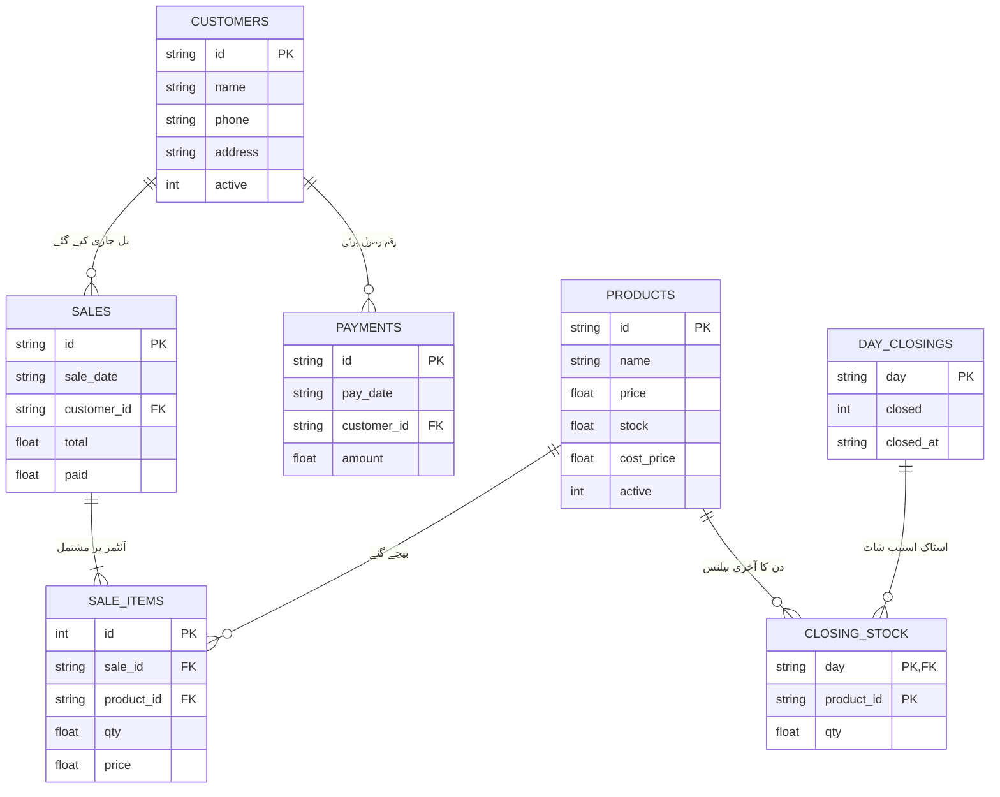

# ڈیٹا بیس اسٹرکچر اور ریلیشن شپس (Database & Storage Architecture Map)

یہ دستاویز **INNOVISTA** ایپلیکیشن کے ڈیٹا اسٹوریج، ان میموری اسٹیٹ، براؤزر `localStorage`، اور اینڈرائیڈ SQLite اسکیما کی مکمل تکنیکی تفصیل فراہم کرتی ہے۔

---

## 1. ڈیٹا کا دوہرا نظام (Dual-Layer Storage Architecture)

ایپلیکیشن آف لائن فرسٹ (Offline-First) اور ہائبرڈ ماڈل پر ڈیزائن کی گئی ہے:

1. **ان میموری سنگل اسٹیٹ (`S`)**: تمام آپریشنز تیز رفتار میموری آبجیکٹ `S` پر پرفارم ہوتے ہیں۔
2. **براؤزر / ویب موڈ (PWA)**: ڈیٹا خودکار طور پر `localStorage` میں `innovista_v1` اور `innovista_v1_bak` (بیک اپ کی) کے تحت محفوظ ہوتا ہے۔
3. **اینڈرائیڈ نیٹو موڈ (APK via Capacitor)**: `@capacitor-community/sqlite` پلگ ان کے ذریعے ایک مکمل ریلیشنل SQLite ڈیٹا بیس (`innovista.db`) کے اندر ٹرانزیکشنز کے تحت سنک ہوتا ہے۔

---

## 2. میموری آبجیکٹ اسٹیٹ (`S`) کا اسٹرکچر

```json
{
  "cur": "2026-11-19",
  "products": [
    { "id": "prod_1", "name": "سیب کا جوس", "price": 120, "stock": 45 }
  ],
  "customers": [
    { "id": "cust_1", "name": "خان جنرل اسٹور", "phone": "03001234567" }
  ],
  "sales": [
    {
      "id": "sale_1",
      "date": "2026-11-19",
      "cust": "cust_1",
      "items": [
        { "pid": "prod_1", "qty": 5, "price": 120 }
      ],
      "total": 600,
      "paid": 400
    }
  ],
  "pays": [
    { "id": "pay_1", "date": "2026-11-19", "cust": "cust_1", "amt": 200 }
  ],
  "days": {
    "2026-11-18": {
      "closed": true,
      "closing": { "prod_1": 50 }
    }
  },
  "cfg": {
    "lock": false,
    "shop": "INNOVISTA",
    "note": "Inventory Management",
    "theme": "white",
    "low": 10,
    "near": 30,
    "cards": {
      "sales": "Total sales",
      "units": "Units sold",
      "stock": "Stock remaining",
      "recv": "Payments received",
      "due": "Total outstanding"
    },
    "hide": {}
  }
}
```

---

## 3. SQLite ڈیٹا بیس ٹیبلز (Relational Schema)

### ٹیبل 1: `products` (انوینٹری کی مصنوعات)
| کالم کا نام | ڈیٹا ٹائپ | تفصیل (Urdu Description) |
|---|---|---|
| `id` | TEXT PRIMARY KEY | پروڈکٹ کا منفرد کوڈ (UID) |
| `name` | TEXT NOT NULL | پروڈکٹ کا نام |
| `price` | REAL NOT NULL DEFAULT 0 | فروخت کی قیمت |
| `stock` | REAL NOT NULL DEFAULT 0 | گودام/دکان میں موجودہ مقدار |
| `cost_price` | REAL NOT NULL DEFAULT 0 | خریداری لاگت (مستقبل کے فیچرز کیلئے) |
| `barcode` | TEXT | بارکوڈ اسکیننگ فیلڈ |
| `unit` | TEXT | ناپ تول کی اکائی (مثلاً کلو، کارٹن، درجن) |
| `active` | INTEGER DEFAULT 1 | فعال یا غیر فعال اسٹیٹس |
| `created_at` | TEXT | اندراج کا وقت |
| `updated_at` | TEXT | آخری تبدیلی کا وقت |

### ٹیبل 2: `customers` (دکاندار / کھاتے دار)
| کالم کا نام | ڈیٹا ٹائپ | تفصیل (Urdu Description) |
|---|---|---|
| `id` | TEXT PRIMARY KEY | دکاندار کا منفرد شناختی کوڈ |
| `name` | TEXT NOT NULL | دکاندار / دکان کا نام |
| `phone` | TEXT | رابطہ نمبر |
| `address` | TEXT | دکان کا پتہ |
| `active` | INTEGER DEFAULT 1 | فعال اسٹیٹس |
| `created_at` | TEXT | کھاتہ کھلنے کا وقت |

### ٹیبل 3: `sales` (سیلز کے بل / رسومات)
| کالم کا نام | ڈیٹا ٹائپ | تفصیل (Urdu Description) |
|---|---|---|
| `id` | TEXT PRIMARY KEY | بل کا منفرد واؤچر نمبر |
| `sale_date` | TEXT NOT NULL | بل بننے کی تاریخ (`YYYY-MM-DD`) |
| `customer_id` | TEXT REFERENCES customers(id) | دکاندار کا فارن کی لنک |
| `total` | REAL NOT NULL DEFAULT 0 | بل کی کل رقم |
| `paid` | REAL NOT NULL DEFAULT 0 | موقع پر نقد وصول شدہ رقم |
| `discount` | REAL DEFAULT 0 | بل پر دی گئی رعایت |
| `note` | TEXT | کوئی خاص یادداشت یا نوٹ |

### ٹیبل 4: `sale_items` (بل میں شامل اشیاء)
| کالم کا نام | ڈیٹا ٹائپ | تفصیل (Urdu Description) |
|---|---|---|
| `id` | INTEGER PRIMARY KEY AUTOINCREMENT | لائن آئٹم سیریل نمبر |
| `sale_id` | TEXT REFERENCES sales(id) ON DELETE CASCADE | مین بل کے ساتھ ریلیشن |
| `line_no` | INTEGER DEFAULT 0 | آئٹم کا ترتیب نمبر |
| `product_id` | TEXT REFERENCES products(id) | خریدی گئی پروڈکٹ کا لنک |
| `qty` | REAL NOT NULL | فروخت شدہ مقدار |
| `price` | REAL NOT NULL | اس وقت فروخت کی گئی منجمد قیمت |

### ٹیبل 5: `payments` (ادائیگیوں کی وصولی)
| کالم کا نام | ڈیٹا ٹائپ | تفصیل (Urdu Description) |
|---|---|---|
| `id` | TEXT PRIMARY KEY | رسید کا نمبر |
| `pay_date` | TEXT NOT NULL | رقم ملنے کی تاریخ |
| `customer_id` | TEXT REFERENCES customers(id) | ادائیگی کرنے والے دکاندار کا لنک |
| `amount` | REAL NOT NULL | موصول شدہ رقم |
| `method` | TEXT | کیش، بینک، ایزی پیسہ وغیرہ |
| `note` | TEXT | اضافی تفصیل |

### ٹیبل 6: `day_closings` (روزانہ کا کھاتہ بندش)
| کالم کا نام | ڈیٹا ٹائپ | تفصیل (Urdu Description) |
|---|---|---|
| `day` | TEXT PRIMARY KEY | بند کیے گئے دن کی تاریخ |
| `closed` | INTEGER DEFAULT 1 | بندش کی تصدیق |
| `closed_at` | TEXT | دن بند کرنے کا صحیح ٹائم اسٹیمپ |

### ٹیبل 7: `closing_stock` (دن کے اختتام پر بچا ہوا اسٹاک)
| کالم کا نام | ڈیٹا ٹائپ | تفصیل (Urdu Description) |
|---|---|---|
| `day` | TEXT REFERENCES day_closings(day) | کلوزنگ ڈے کا لنک |
| `product_id` | TEXT NOT NULL | پروڈکٹ کوڈ |
| `qty` | REAL NOT NULL | اس دن کے اختتام پر بچی ہوئی مقدار |

### ریزروڈ ٹیبلز برائے مستقبل (Reserved Tables):
- `suppliers` : مال سپلائی کرنے والی کمپنیوں کا ریکارڈ
- `purchases` & `purchase_items` : خریداری کے بل اور آئٹمز
- `expenses` : روزمرہ دکان کے اخراجات (چائے، کرایہ، بل وغیرہ)
- `stock_movements` : اسٹاک کی ہر منتقلی کا آڈٹ ٹریل
- `users` & `audit_log` : ملٹی یوزر، سیلزمین لاگ ان اور تبدیلیوں کا ریکارڈ
- `meta` & `settings` : سسٹم کنفیگریشن اور اسکیما ورژن (`schema_version = 1`)

---

## 4. ڈیٹا بیس ویوز برائے اینالیٹکس (Analytical Views)

1. **`v_customer_balance`**:
   ہر دکاندار کی کل سیلز، کل ادائیگیاں، اور موجودہ نیٹ واجب الادا رقم (`billed - paid AS balance`) فوری نکالتا ہے۔
2. **`v_daily_summary`**:
   روزانہ کی بنیاد پر کل کٹے گئے بلوں کی تعداد، بکے ہوئے یونٹس، مجموعی سیلز کی رقم اور موصول شدہ کیش کا خلاصہ فراہم کرتا ہے۔
3. **`v_daily_product_sales`**:
   کسی بھی تاریخ پر کون سا پروڈکٹ کتنی مقدار اور کتنی رقم میں فروخت ہوا اس کا الگ الگ حساب پیش کرتا ہے۔
4. **`v_stock_value`**:
   فعال پروڈکٹس کی مجموعی تعداد، گودام کے کل یونٹس اور انوینٹری کی کل مالیت (`SUM(stock * price)`) دکھاتا ہے۔

---

## 5. ڈیٹا بیس اینٹیٹی ریلیشن شپ ڈایاگرام (ER Diagram)



