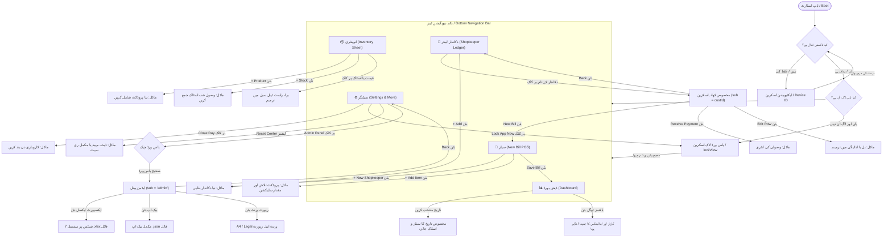

# نیویگیشن میپ اور اسکرین فلو (Navigation Map & Screen Flow)

یہ دستاویز **INNOVISTA** ایپلیکیشن کے تمام اسکرینز، سب اسکرینز، ٹیبز، ماڈلز اور ان کے درمیان نقل و حرکت (Navigation Flow) کی جامع وضاحت پیش کرتی ہے۔

---

## 1. نیویگیشن اسٹرکچر اور اسٹیٹ آرکیٹیکچر (State Architecture)

ایپلیکیشن مکمل طور پر ایک سنگل پیج آرکیٹیکچر (SPA) ہے جس کی نیویگیشن 4 مرکزی اسٹیٹ متغیرات (State Variables) سے کنٹرول ہوتی ہے:

- `unlocked` (Boolean): کیا ایپ ان لاک ہے؟ اگر `false` ہو تو صرف `lockView()` اسکرین نظر آئے گی۔
- `tab` (String): مرکزی باٹم نیویگیشن بار کے 5 بنیادی ٹیبز:
  - `'dash'` : Dashboard (مرکزی ڈیش بورڈ)
  - `'inv'` : Inventory (اسٹاک شیٹ اور پروڈکٹس)
  - `'sales'` : Sales (نیا بل پوائنٹ آف سیل)
  - `'cust'` : Ledger (دکانداروں کا کھاتہ)
  - `'more'` : Settings (ترتیبات اور ری سیٹ سینٹر)
- `sub` (String | null): موجودہ ٹیب کی ذیلی اسکرین:
  - اگر `tab == 'cust'` اور `sub == customer_id`: اس مخصوص دکاندار کا مکمل تفصیلی کھاتہ۔
  - اگر `tab == 'more'` اور `sub == 'admin'`: ایڈمن پینل اسکرین۔
- `bill` (Object | null): اگر سیلز میں بل جاری ہو تو بل کی اسٹیٹ برقرار رہتی ہے۔

---

## 2. بصری فلو چارٹ (Visual Navigation Flowchart)

---

## 3. تمام اسکرینز اور ان کی تفصیل (Screens & Associated Functions)

| اسکرین کا نام | اسٹیٹ کنڈیشن | ذمہ دار فنکشن | اہم فیچرز |
|---|---|---|---|
| **Activation Screen** | `!LIC.info` | `screen()` (`license.js`) | ڈیوائس آئی ڈی دکھانا، واٹس ایپ شیئر، ایکٹیویشن کی پیسٹ کر کے ایپ کھولنا۔ |
| **Lock Screen** | `!unlocked` | `lockView()` | ماسٹر پاس ورڈ مانگنا، PBKDF2 توثیق اور ایپ ان لاک کرنا۔ |
| **Dashboard** | `tab == 'dash'` | `dash()` | مجموعی سیلز، وصول شدہ کیش، بقایا رقم، اسٹاک چارٹ، ڈیلی سیلز شیٹ۔ |
| **Inventory Sheet** | `tab == 'inv'` | `inv()` | لائیو ایکسل گرڈ، پروڈکٹ سرچ، پرائس اور اسٹاک کی براہ راست ترمیم، نیا آئٹم شامل کرنا۔ |
| **New Bill (POS)** | `tab == 'sales'` | `sales()` | دکاندار کا انتخاب، سرچ ایبل پروڈکٹ پکر سے آئٹم ایڈ کرنا، نقد وصولی درج کر کے بل سیو کرنا۔ |
| **Shopkeeper Ledger** | `tab == 'cust' && !sub` | `custs()` | تمام دکانداروں کی لسٹ، سرچ، فلٹرز (زیادہ بقایا، الف تا ے)، مجموعی واجب الادا رقم۔ |
| **Customer Account** | `tab == 'cust' && sub` | `custs()` | انفرادی دکاندار کی تاریخ وار اسٹیٹمنٹ، ٹرانزیکشن ہسٹری، ادائیگی وصولی، بل ترمیم۔ |
| **Settings & More** | `tab == 'more' && !sub` | `more()` | تھیم اور برائٹنس کنٹرول، ڈے کلوزنگ، دستی ایپ لاک، ری سیٹ سینٹر۔ |
| **Admin Panel** | `tab == 'more' && sub == 'admin'` | `admin()` | ایکارڈین سیکشنز: لاک پاس ورڈ سیٹنگ، کارڈز نام ایڈیٹر، CSV امپورٹ، ایکسل بیک اپ، پی ڈی ایف/پرنٹ رپورٹس۔ |

