# INNOVISTA Inventory Management

Created by **Zeeshan Sarwar**. A mobile-first stock, billing and shopkeeper-ledger app with Excel-style sheets. It is one self-contained web app (`www/index.html`, vanilla JS, no build step) that runs in any browser, installs as a PWA, and can be wrapped into an Android APK with Capacitor.

> اردو نوٹ: اس فولڈر کو `C:\Users\hp\Downloads\Innovista Ap` میں کھولیں۔ ایپ چلانے کے لیے `www\index.html` ڈبل کلک کریں۔ APK بنانے کا طریقہ نیچے "Android APK" میں ہے۔

## Screenshots

| Dashboard | Inventory | New bill |
|---|---|---|
| 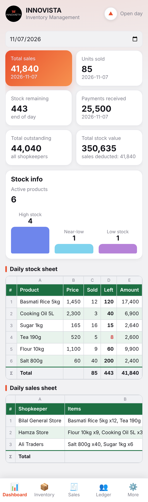 | 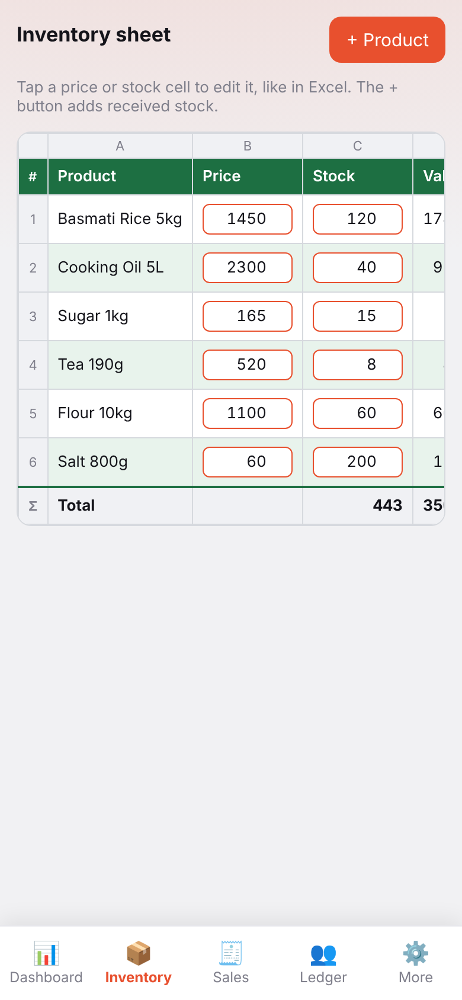 | 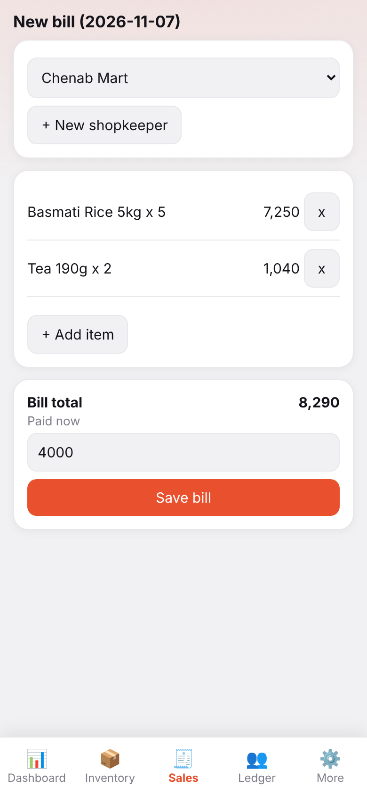 |

| Shopkeeper ledger | Reset center | Admin panel |
|---|---|---|
| 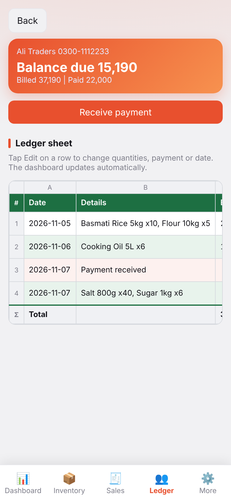 | 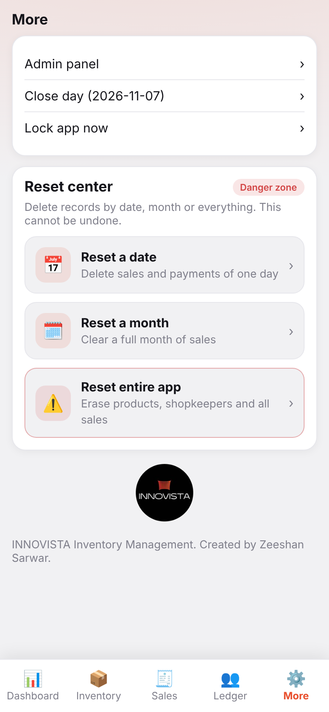 | 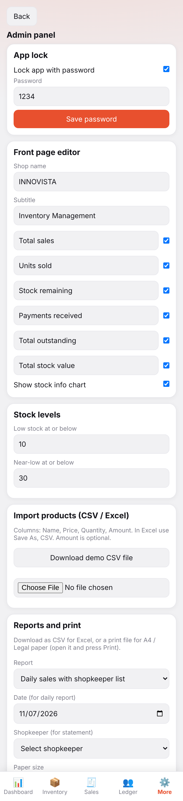 |

Tablet layout:

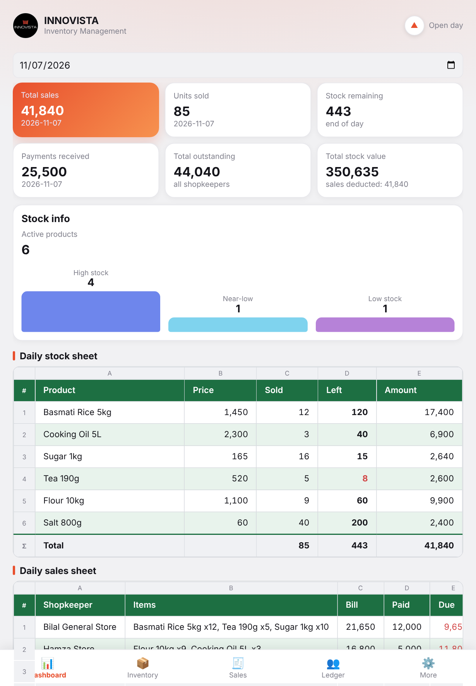
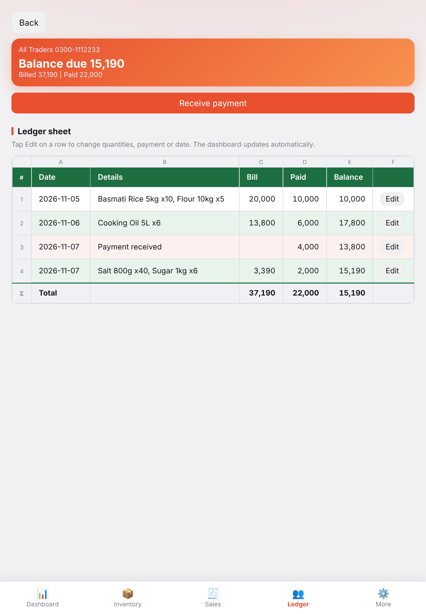

Repository: https://github.com/zeeshansarwar1986/INNOVISTA-Inventory-Management-for-Mobile-Tab

## 1. Folder structure

```
Innovista Ap/
  README.md                this guide
  package.json             npm scripts, Capacitor + xlsx dependencies
  capacitor.config.json    Android wrapper settings (appId com.innovista.inventory)
  build-apk.bat            one-click debug APK build on Windows
  .github/workflows/build-apk.yml   builds the APK on GitHub (no local Android setup)
  keygen/                  INNOVISTA Key Generator (separate app for the owner phone)
  tools/                   protect.js (obfuscation build step), set-public-key.js
  docs/LICENSING.md        activation keys, device ID, security and limits
  www/
    license.js, license-config.js   activation screen and key check
    index.html             THE APP (HTML + CSS + JS in one file)
    manifest.webmanifest   PWA manifest (install to home screen)
    sw.js                  service worker (offline cache)
    icons/                 192 and 512 px icons from the INNOVISTA logo
    vendor/                created by `npm run vendor` (offline copy of SheetJS)
  db/schema.sql            SQLite schema (tables, indexes, views)
  docs/DATABASE.md         database design, sync flow, migration and next steps
  www/db.js                SQLite adapter (native app only)
  data/
    innovista-demo.db      demo SQLite database (open with DB Browser for SQLite)
    sample-backup.json     demo data: Admin panel > Restore from a backup file
    products-demo.csv      demo product import file
  docs/screenshots/        phone and tablet screenshots
```

The APK itself is **not** included: it must be built with the Android toolchain (section 4).

## 2. Run it

- Quick look: double-click `www/index.html`. App data is saved in that browser.
- Local server (needed for the PWA service worker): `npm install`, then `npm run serve`, open http://localhost:8080.
- Default admin password: `1234` (lock is off until enabled in Admin panel). Change it first.
- Load demo data: More > Admin panel > Restore from a backup file > `data/sample-backup.json`.

## 3. Features (what the app does)

| Screen | What it does |
|---|---|
| Dashboard | Date picker. Cards: Total sales, Units sold, Stock remaining, Payments received, Total outstanding, Total stock value (current stock x sale price, falls as sales happen). Arrow button folds the cards so the sheets move up. Stock info bars (high / near-low / low). Daily stock sheet (sold, left) and Daily sales sheet. |
| Inventory | Excel-style sheet. Price and stock cells are editable in place. "+" adds received stock. Add product. |
| Sales | Pick a shopkeeper (or add one), add items, enter the amount paid now, save. Stock is checked and reduced. |
| Ledger | Table of shopkeepers (name, phone, due, total sale) with search, sort and a due-only filter; tap a phone number to call. Tap a name for the full account: totals, a date-wise account and every entry. Tap a name for the full account with running balance. Edit button on every bill (quantities, paid, date, delete) and payment (amount, date, delete). Receive payment button. |
| More > Close day | Saves the day's closing stock snapshot, moves to the next date. Choose: carry remaining stock, or start fresh (stock set to 0, then add new stock). |
| More > Reset center | Reset one date, one month, or the entire app (type RESET). Settings and password are kept on full reset. |
| Admin panel | Accordion sections for phones. Asks the app password again when opened. App lock + hashed password, shop name, card titles and visibility, low / near-low thresholds, CSV product import with demo file, reports (CSV and A4 / Legal print files), full Excel workbook, JSON backup and restore. |

Large catalogs (200+ products): Inventory has a search box and edits happen in place (no scroll jump); the bill "Add item" dialog has a searchable product list.

Business rules worth knowing:
- Stock only changes through: product creation, "+" stock, editing a stock cell, a bill, bill edit or delete, CSV import, Close day (fresh), Reset.
- Editing or deleting a bill of a past (closed) date changes **today's** stock, not that day's stored closing snapshot.
- Reset of the current date returns the stock of the deleted bills; reset of a closed date does not touch stock.
- Total stock value uses the sale price (there is no cost price yet).
- Auto-refresh: every 20 seconds, on returning to the app, and by pull-down at the top of the screen.

## 4. Android APK

The same `www` folder is wrapped by Capacitor. Three ways, easiest first. None was run in the environment that produced this package, so expect to adjust version numbers.

**A. GitHub Actions (no Android setup on your PC)**
1. Create a GitHub repository and upload this whole folder (including the `.github` folder).
2. Repository > Actions > "Build Android APK" > Run workflow.
3. Download `innovista-debug-apk` from the run's Artifacts, unzip, copy `app-debug.apk` to the phone, install (allow unknown sources).

**B. Windows script**
1. Install Node.js 18+, JDK 17 and Android Studio (it installs the Android SDK).
2. Double-click `build-apk.bat`. The APK appears at `android\app\build\outputs\apk\debug\app-debug.apk`.

**C. Android Studio**
`npm install`, `npm run android:add`, `npm run android:sync`, `npm run android:open`, then Build > Build APK(s).

Release (Play Store): create a keystore (`keytool -genkey ...`), build a signed AAB in Android Studio (Build > Generate Signed Bundle), keep the keystore out of git (already in `.gitignore`).

Known Android caveats:
- File downloads (xlsx, csv, print files) use a browser-style download. In the Capacitor WebView this may not save files. Fix: add `@capacitor/filesystem` and `@capacitor/share`, and replace `blobDL()` in `www/index.html` to write the file and open the share sheet.
- Data lives in WebView `localStorage`. Android can clear it if the user clears app storage or uninstalls. Weekly backup is advised until the data layer moves to SQLite (see roadmap).
- The Excel export loads SheetJS from `www/vendor/` (created by `npm run vendor`) and falls back to the cdnjs CDN.

## 4a. Activation key and Key Generator

The Inventory app asks for an activation key on its first screen and shows its Device ID (copy or WhatsApp). The owner makes the key with the separate **INNOVISTA Key Generator** app (`keygen/`). Read `docs/LICENSING.md` first: it explains the owner steps, the signing-key rule, the protection measures and the honest limits. Before building the APK put the public key from the Key Generator into `public-key.json`.

| Activation screen | Key Generator | Admin panel with License |
|---|---|---|
| 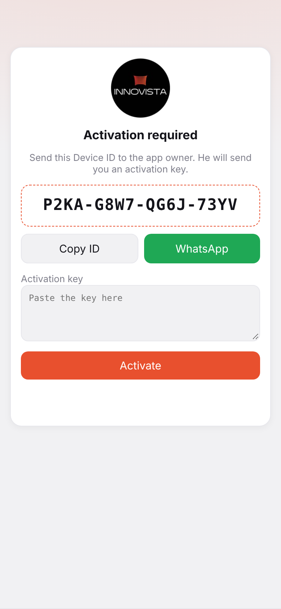 | 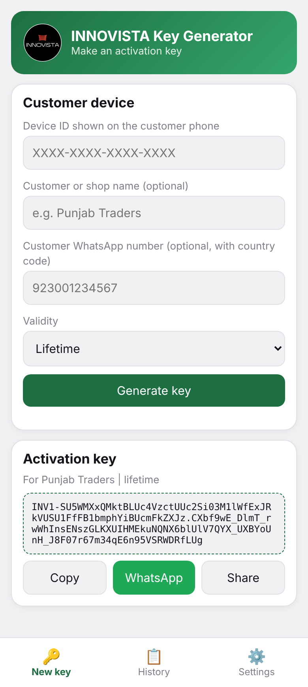 | 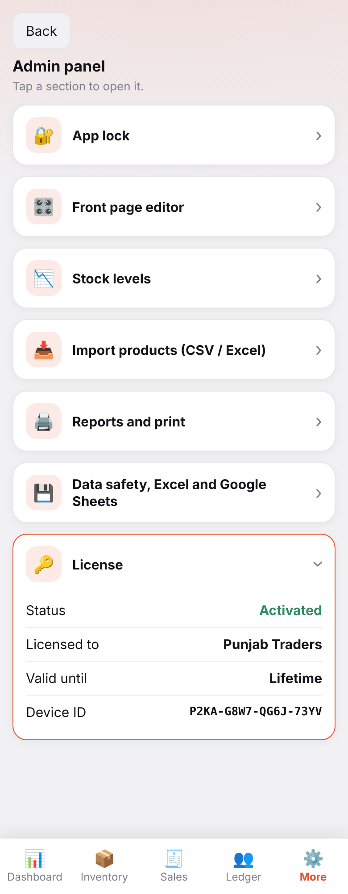 |

## 4b. Database (SQLite)

In the Android app the data is stored in a SQLite database (`www/db.js`, schema in `db/schema.sql`). In a browser or PWA the app keeps using localStorage. A localStorage copy is always kept as a second safety copy. Full details, table list, sync flow and the migration plan are in `docs/DATABASE.md`.

## 5. Screen sizes

Responsive by CSS only: phones (under 700 px, 2 card columns), tablets (700 px and up, 3 columns, larger sheet text, centered dialogs), desktop (1100 px and up, wider layout). Sheets keep sticky column letters, header row, row numbers and the total row, and scroll inside their own frame. Check with Chrome DevTools device toolbar at 360, 390, 820 and 1280 px. Screenshots are in `docs/screenshots/`.

## 6. Architecture for developers

Single file, no framework. UI is rebuilt with `innerHTML` on every change by `draw()`; state is one object `S` in memory, saved after each change.

**Storage keys** (localStorage): `innovista_v1` (state), `innovista_v1_bak` (second copy, used if the first is corrupt), `innovista_v1_ui` (last screen: tab, date, open ledger, unsaved bill).

**State shape**
```
S = {
  cur: "YYYY-MM-DD",                       // the open business day
  products:  [{id,name,price,stock}],
  customers: [{id,name,phone}],
  sales: [{id,date,cust,items:[{pid,qty,price}],total,paid}],
  pays:  [{id,date,cust,amt}],             // later payments received
  days:  {"YYYY-MM-DD":{closing:{pid:qty},closed:true}},
  cfg:   {lock,pw,shop,note,low,near,fold,cards:{...titles},hide:{...}}
}
```
Balance of a shopkeeper = sum(sale.total - sale.paid) - sum(payments).

**Key functions in `www/index.html`**
- State and storage: `save`, `saveUI`, `refresh`, `fixCfg`, `def`.
- Views: `dash`, `inv`, `sales`, `custs` / `custs1`, `more`, `admin` / `admin0` / `admin1`, `lockView`, `draw` (wrapped several times at the end of the file).
- Sheet UI: `sheet(headers, rows, footer, alignments)` builds the Excel-like table.
- Business: `dayData(date)`, `saveBill`, `editBill`, `editPay`, `closeDay`, `rmRange`, `rDate`, `rMonth`, `rAll`.
- Import and export: `parseCSV`, `impParse`, `applyImp`, `repData`, `toCSV`, `toHTML`, `exportXLSX`, `exportJSON`, `restoreFile`, `dl` / `dlBin` / `blobDL`.

Several features were added by redefining a function later in the file (the last `function name` wins). Cleaning this up into one definition per function is a good first refactor.

**Security note:** the password lock is client-side only (stored in localStorage in plain text). It stops casual use, not a determined user. Real security needs a backend (roadmap).

## 7. Testing checklist
1. Add products, add a shopkeeper, make a bill with partial payment. Check dashboard, ledger balance and stock.
2. Edit the bill quantity and the payment. Dashboard and balance must follow.
3. Close day with "carry" and with "fresh". Open the old date: sold and left must show.
4. Reset date, month, app. Check stock return rules above.
5. Import `data/products-demo.csv` (add and overwrite modes). Restore `data/sample-backup.json`.
6. Force-close the browser during an unsaved bill; reopen: the bill is restored.
7. Rotate the phone and open on a tablet: no horizontal page scroll.

## 8. Roadmap (suggested order)

**Phase 1: data safety and sync**
- Backend (FastAPI + PostgreSQL or SQLite) with login; app syncs bills, stock and payments.
- Google Sheets sync from the backend (service account, append one row per bill and per payment, daily summary tab).
- Move local storage to SQLite (Capacitor SQLite) or IndexedDB.

**Phase 2: accounting depth**
- Purchases, suppliers and supplier ledger; expenses.
- Cost price per product, profit and loss report, margin per product.
- Discount, tax, returns, add or remove items inside an existing bill, bill numbers.
- Overdue reminders for shopkeepers (WhatsApp / SMS share).

**Phase 3: roles and devices**
- Users and roles (owner, manager, salesman), audit log of edits and deletes.
- Multi-shop or multi-branch.

**Phase 4: field features**
- Thermal receipt printing (Bluetooth ESC/POS) and PDF bills.
- Barcode scanning with the phone camera.
- Low-stock notifications, weekly and monthly charts.
- Urdu (RTL) interface with language switch.
- Real offline-first sync with conflict handling.

**Phase 5: release**
- Signed AAB on Google Play, iOS build with Capacitor, app icon set (adaptive icon), splash screen.

## 9. Credits
INNOVISTA Inventory Management. Created by Zeeshan Sarwar.
