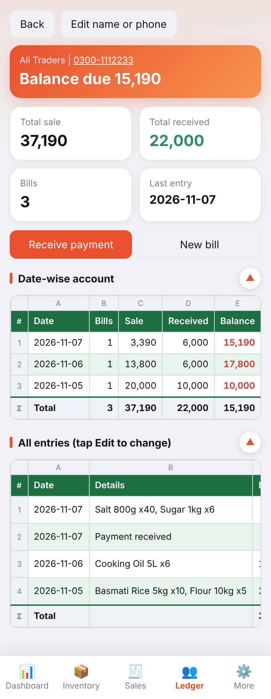

# INNOVISTA Inventory Management

<p align="center">
  
</p>

<p align="center">
  <strong>Production-Grade Mobile, Tablet & Android Stock, Billing & Shopkeeper Ledger Solution</strong><br>
  <em>Engineered for Speed, Complete Offline Autonomy, Excel-Style Usability, and Cryptographic Security</em>
</p>

<p align="center">
  <a href="#license"></a>
  <a href="#platform"></a>
  <a href="#tech-stack"></a>
  <a href="#android-sdk"></a>
  <a href="#offline"></a>
  <a href="README_URDU.md"></a>
</p>

---

## 📖 Language Switcher / زبان کا انتخاب

* 🇬🇧 **English Documentation:** [Current Document (README.md)](#table-of-contents)
* 🇵🇰 **مکمل اردو دستاویزات و رہنما:** [README_URDU.md (اردو گائیڈ پڑھیں)](README_URDU.md)

---

## 📑 Table of Contents

1. [Executive Summary](#1-executive-summary)
2. [Visual Gallery & Screenshots](#2-visual-gallery--screenshots)
3. [Core Capabilities & System Modules](#3-core-capabilities--system-modules)
4. [Technology Stack & Architectural Design](#4-technology-stack--architectural-design)
5. [End-User Operation Manual](#5-end-user-operation-manual)
6. [Business Invariants & Accounting Rules](#6-business-invariants--accounting-rules)
7. [Developer & Build Guide (Android APK)](#7-developer--build-guide-android-apk)
8. [Cryptographic Licensing & Key Generator](#8-cryptographic-licensing--key-generator)
9. [Database Engine & Dual-Layer Persistence](#9-database-engine--dual-layer-persistence)
10. [Repository Structure](#10-repository-structure)
11. [Troubleshooting & FAQ](#11-troubleshooting--faq)
12. [Author & Acknowledgements](#12-author--acknowledgements)

---

## 1. Executive Summary

**INNOVISTA Inventory Management** is an offline-first stock control, point-of-sale billing, and double-entry style shopkeeper ledger (Khata) application. Designed by **Muhammad Zeeshan Sarwar**, it bridges the speed and simplicity of spreadsheet computing (Microsoft Excel) with native mobile convenience on Android smartphones and tablets.

### Why INNOVISTA?
* **Zero Runtime Overhead:** Built in pure, vanilla JavaScript (ES6+), modern CSS3 variables, and semantic HTML5. No bloated front-end frameworks, resulting in sub-millisecond view repaints and instant app boots.
* **100% Offline Capability:** Runs completely self-contained in air-gapped retail environments without recurring cloud subscriptions, internet connections, or remote backend latency.
* **Dual-Engine Persistence:** Leverages high-performance relational **SQLite** on native Android via Capacitor, coupled with automatic transactional sync to browser **LocalStorage** as a fail-safe redundancy copy.
* **Cryptographic Hardware Licensing:** Employs **ECDSA P-256** digital signatures (WebCrypto Subtle API) and SHA-256 hashed Android hardware IDs to prevent unauthorized key sharing across multiple devices.
* **Enterprise-Ready Reports:** Exports full multi-sheet Excel workbooks (`.xlsx`), comma-separated tables (`.csv`), print-ready A4/Legal accounting statements, and encrypted JSON disaster recovery snapshots.

---

## 2. Visual Gallery & Screenshots

### Mobile Experience (Phones)

| Dashboard Overview | Editable Inventory Sheet | Point-of-Sale Billing |
|:---:|:---:|:---:|
|  |  |  |

| Shopkeeper Ledger Directory | Customer Account Running Balance | More & Reset Center |
|:---:|:---:|:---:|
|  |  |  |

### Enterprise Administration & Tablet Mode

| Accordion Admin Panel | Tablet Dashboard Grid | Tablet Full Ledger View |
|:---:|:---:|:---:|
|  |  |  |

### Cryptographic Security & Activation

| Device ID Activation Screen | Owner Key Generator App | Active License in Admin |
|:---:|:---:|:---:|
|  |  |  |

---

## 3. Core Capabilities & System Modules

### 1. Dashboard & Analytics
* **Daily Metric Cards:** Real-time calculation of Gross Sales, Total Units Sold, Remaining Inventory, Cash Collected, Market Outstandings (Receivables), and Total Inventory Stock Value at Sale Price.
* **Collapsible Overview:** One-tap chevron fold button collapses summary cards to maximize vertical screen space for active data sheets.
* **Stock Health Indicators:** Visual tripartite progress monitors classifying stock levels into High, Near-Low, and Low warnings based on user-defined thresholds.
* **Date-Wise Inspection:** Seamless date-picker to view historical sales, closing stock, and ledger transitions for any business day.

### 2. Live Excel-Style Inventory
* **Direct In-Cell Editing:** Modify retail prices and on-hand stock numbers directly inside sheet cells without opening modals or triggering viewport scroll-jumps.
* **Incremental Inward Stocking:** Fast `+` action button on each line item to instantly add new batch receipts.
* **Live Catalog Filter:** Instant search bar filtering across hundreds of SKUs with zero input lag.

### 3. POS Billing & Stock Deduction
* **Searchable Item Picker:** Real-time stock availability check preventing accidental overselling.
* **Split Settlement:** Immediate cash collection (`Paid Now`) calculation with automatic deferral of unpaid balance to the customer's ledger.
* **Invoice Editing:** Historical invoices can be updated or voided; amendments automatically update today's live stock balance.

### 4. Shopkeeper Ledger (Khata) & CRM
* **Directory Search & Sorting:** Filter customer accounts alphabetically or by highest outstanding balance (`With due only`).
* **Direct Telephony Integration:** Tap-to-dial (`tel:`) and WhatsApp deep links (`https://wa.me/`) for payment follow-ups.
* **Statement of Account:** Chronological itemized transaction view with date-wise running balances and partial payment entries.

### 5. Daily Closings & Reset Controls
* **Day Close Wizard:** Freezes end-of-day stock counts into immutable historical snapshots; offers options to carry remaining stock forward or reset to zero for fresh batch receipts.
* **Granular Reset Center:** Roll back an individual date, clear an entire calendar month, or perform a guarded complete factory wipe (`RESET` safeguard).

### 6. Admin Panel & Data Governance
* **Salted Password Protection:** Hardened with PBKDF2 (100,000 iterations) salted hashing.
* **Automated Data Exports:** Export multi-tab Excel workbooks via SheetJS, CSV inventory dumps, and formatted A4 / Legal print sheets.
* **Backup & Restore:** Full state JSON backup and one-click import restoration.

---

## 4. Technology Stack & Architectural Design

```
+-------------------------------------------------------------------------+
|                        INNOVISTA FRONT-END                              |
|   HTML5 Semantic Shell  *  CSS3 Custom Properties  *  Vanilla JS (ES6+) |
|       (Reactive View Rendering via Single State Object 'S')             |
+--------------------+------------------------------+--------------------+
                     |                              |                     
                     v                              v                     
       +----------------------------+  +----------------------------+     
       | WebCrypto Cryptography     |  | SheetJS (xlsx.full.min.js) |     
       |  - ECDSA P-256 Signature   |  |  - Multi-Sheet Workbooks   |     
       |  - PBKDF2 100k Password    |  |  - CSV Importer/Exporter   |     
       +----------------------------+  +----------------------------+     
                     |                              |                     
                     +--------------+---------------+                     
                                    |                                     
                                    v                                     
+-------------------------------------------------------------------------+
|                      RUNTIME & PERSISTENCE LAYER                        |
|                                                                         |
|   +--------------------------+          +---------------------------+   |
|   | Native Android Platform  |          | Web / PWA Runtime         |   |
|   |  - Capacitor 6.2.0       |          |  - Service Worker (sw.js) |   |
|   |  - SQLite Engine (db.js) |          |  - Web Storage API        |   |
|   |  - Device Hardware ID    |          |  - Browser Seed Token     |   |
|   +--------------------------+          +---------------------------+   |
+-------------------------------------------------------------------------+
                                    |                                     
                                    v                                     
+-------------------------------------------------------------------------+
|                      ANDROID NATIVE BUILD CHAIN                         |
|   OpenJDK 21 LTS * Android SDK 34/36 * AAPT2 * D8 DEX * ZipAlign * Sign |
+-------------------------------------------------------------------------+
```

### Component Details

| Domain | Technology / Tool | Role in INNOVISTA |
|---|---|---|
| **Core Language** | Modern JavaScript (ES6+) | Application logic, view rendering, DOM diffing |
| **Styling** | Modern CSS3 | Responsive grid, custom design tokens, dark/light themes |
| **Hybrid Bridge** | Capacitor 6.2.0 | Native bridge for Android WebView and plugin interfaces |
| **Relational DB** | SQLite 3 (`@capacitor-community/sqlite`) | ACID transactional native relational persistence |
| **Fail-Safe Storage** | HTML5 `localStorage` | Redundant offline state persistence and browser fallback |
| **Cryptography** | WebCrypto API (`crypto.subtle`) | ECDSA P-256 signature verification & PBKDF2 hashing |
| **Obfuscation** | `javascript-obfuscator` | Build-time string array encryption and symbol obfuscation |
| **Android Toolchain** | Android SDK Tools, AAPT2, D8, Gradle | Compiling, linking, packaging, and signing the APK |

---

## 5. End-User Operation Manual

### Step 1: Initial Deployment & Security Setup
1. Transfer `app-debug.apk` or `Innovista-Inventory-v1.0.apk` to your Android device and install it (enable "Install from Unknown Sources" if prompted).
2. Launch the application. The system initializes to today's date automatically.
3. Open **More > Admin Panel**. Default setup password is `1234`.
4. Immediately navigate to **App Lock**, input a strong personal password, and toggle the lock switch to **On**.

### Step 2: Registering Products & Loading Inventory
1. Navigate to **Inventory** in the bottom tab bar.
2. Tap **+ Add Product**, enter the product title, selling price, and opening inventory count.
3. **Bulk CSV Import:** If you maintain inventory on an existing spreadsheet, export it to CSV with headers `name,price,stock` and import it directly via **Admin Panel > Import Products (CSV)**.
4. **Receiving Stock:** When a new delivery arrives from suppliers, tap the `+` button in that product's row to increment on-hand inventory.

### Step 3: Executing Bills & Managing Customer Accounts
1. Tap **Sales** on the bottom navigation bar.
2. Select an existing shopkeeper from the list or tap **+ Add Shopkeeper** (enter name and WhatsApp/mobile number).
3. Tap **Add Item**, search for the SKU, specify quantity, and add it to the cart.
4. Input the cash amount collected under **Paid now**.
5. Tap **Save Bill**. On-hand inventory is immediately debited, and any remaining balance is added to the shopkeeper's dues.

### Step 4: Ledger Settlements
1. Open the **Ledger** tab to view all customer accounts and their total outstanding balance.
2. Tap any customer's name to view their full statement of account with running balance.
3. Tap **Receive payment** whenever cash or bank transfer is received to update their outstanding balance.

---

## 6. Business Invariants & Accounting Rules

1. **Deterministic Stock Mutation:** Inventory levels mutate **only** via: product creation, the `+` inward stock dialog, in-cell inventory editing, bill creation, bill amendments/deletions, CSV imports, and Day Close resets.
2. **Historical Bill Amendment Safeguard:** Amending or voiding a bill from a previous (closed) business date adjusts **today's** live inventory, leaving historical closing snapshots intact to preserve audit integrity.
3. **Current vs. Closed Date Reset:** Resetting the current business date refunds stock associated with deleted invoices; resetting a historical closed date clears records without modifying physical inventory.
4. **Net Ledger Balance Formula:**
   $$\text{Customer Balance} = \sum (\text{Sale Total} - \text{Sale Paid}) - \sum (\text{Payment Received})$$
5. **Inventory Valuation:** Valued strictly at current selling price:
   $$\text{Total Stock Value} = \sum_{p \in \text{Active Products}} (\text{Stock}_p \times \text{Price}_p)$$

---

## 7. Developer & Build Guide (Android APK)

### Prerequisites
* **Java:** OpenJDK 17 or OpenJDK 21
* **Node.js:** Node.js 18+ (LTS) or Bun runtime
* **Android SDK:** Platforms 34 / 36 and Build-Tools 34.0.0 / 36.0.0
* **Gradle:** Gradle 8.2.1+ (included via wrapper)

---

### Build Option A: Standard Capacitor Workflow

```bash
# 1. Inject the cryptographic public key
node tools/set-public-key.js

# 2. Install dependencies
npm install

# 3. Add Android platform (if not already added)
npx cap add android

# 4. Disable cloud backup in manifest for security
powershell -Command "(Get-Content android\app\src\main\AndroidManifest.xml) -replace 'android:allowBackup=\"true\"','android:allowBackup=\"false\"' | Set-Content android\app\src\main\AndroidManifest.xml"

# 5. Build, obfuscate, and synchronize web assets
npm run android:sync

# 6. Build debug APK
cd android
.\gradlew.bat assembleDebug
```

Output APK location:
```text
android\app\build\outputs\apk\debug\app-debug.apk
```

---

### Build Option B: Ultra-Fast 1-Click Native Build

A dedicated Windows PowerShell build pipeline ([tools/build-native-apk.ps1](tools/build-native-apk.ps1)) compiles, dexes, aligns, and signs directly using the underlying Android toolchain (`aapt2`, `javac`, `d8`, `zipalign`, `apksigner`):

```cmd
build-apk-direct.bat
```

Output APK location:
```text
Innovista-Inventory-v1.0.apk
```

---

## 8. Cryptographic Licensing & Key Generator

INNOVISTA includes a standalone cryptographic key generator ([keygen/](keygen/)) designed to run exclusively on the business owner's personal device.

```
Customer Device (Inventory App)              Owner Device (Key Generator)
  Displays Hardware Device ID  -- WhatsApp ->   Owner inputs Device ID
                                                Signs payload with PRIVATE key
  Activates via Signature Key  <- WhatsApp --   Sends activation token
  Verifies with Built-in PUBLIC key
```

### Digital Key Specifications
* **Algorithm:** ECDSA (Elliptic Curve Digital Signature Algorithm) over NIST P-256 (`secp256r1`) with SHA-256.
* **Token Structure:**
  ```text
  INV1-<Base64URL(Payload)>.<Base64URL(Signature)>
  ```
  Where `Payload` is: `INV1|<DeviceID>|<Expiry>|<CustomerName>`.
* **Anti-Tampering:** Refuses keys if the system clock has been rolled back by more than 24 hours.

### CLI Key Creation
Generate a key directly from the terminal using the owner's private key:
```bash
bun tools/make-key.js "4K8P-7W9X-2M3N-5Q1R" "Punjab Traders" "LIFETIME"
```

To toggle mandatory licensing on or off:
```bash
bun tools/toggle-license.js
```

---

## 9. Database Engine & Dual-Layer Persistence

The schema ([db/schema.sql](db/schema.sql)) defines a fully relational structure supporting transactions, foreign keys, cascading deletions, and analytical views:

```sql
-- Relational View for Customer Balance
CREATE VIEW IF NOT EXISTS v_customer_balance AS
 SELECT id, name, phone, billed, paid, billed - paid AS balance FROM (
  SELECT c.id, c.name, c.phone,
   COALESCE((SELECT SUM(total) FROM sales s WHERE s.customer_id = c.id), 0) AS billed,
   COALESCE((SELECT SUM(paid) FROM sales s WHERE s.customer_id = c.id), 0)
   + COALESCE((SELECT SUM(amount) FROM payments p WHERE p.customer_id = c.id), 0) AS paid
  FROM customers c);
```

For complete database entity relationships, schema migrations, and sync queuing mechanisms, refer to [docs/DATABASE.md](docs/DATABASE.md).

---

## 10. Repository Structure

```
INNOVISTA-Inventory-Management/
├── README.md                      # International master documentation
├── README_URDU.md                 # Complete Urdu developer & user manual
├── package.json                   # Node scripts & Capacitor plugin manifests
├── capacitor.config.json          # Android WebView security & wrapper config
├── build-apk.bat                  # Standard Capacitor build script
├── build-apk-direct.bat           # 1-Click direct Android SDK build script
├── public-key.json                # Cryptographic P-256 public key
├── .gitignore                     # Git exclusion rules
│
├── www/                           # Front-End Application (Vanilla JS / SPA)
│   ├── index.html                 # Complete app shell, UI sheets, styling & logic
│   ├── db.js                      # Dual-layer SQLite & LocalStorage sync adapter
│   ├── license.js                 # ECDSA signature verification & Device ID engine
│   ├── license-config.js          # Injected public key settings
│   ├── manifest.webmanifest       # PWA manifest for desktop/mobile install
│   ├── sw.js                      # Offline caching Service Worker
│   └── icons/                     # 192px and 512px application icons
│
├── keygen/                        # INNOVISTA Key Generator (Owner Phone App)
│   ├── package.json
│   ├── capacitor.config.json
│   └── www/                       # Key generator PWA shell
│
├── tools/                         # Build, security & automation utilities
│   ├── build-native-apk.ps1       # Direct SDK assembler & signer pipeline
│   ├── make-key.js                # Command-line activation key generator
│   ├── toggle-license.js          # License requirement toggle utility
│   ├── protect.js                 # JS obfuscation & string array encoding
│   └── set-public-key.js          # Build-time public key injector
│
├── db/                            # Database definitions
│   └── schema.sql                 # SQLite relational schema, indices & views
│
└── docs/                          # Comprehensive technical guides
    ├── DATABASE.md                # SQLite architecture & sync documentation
    ├── LICENSING.md               # Cryptographic licensing manual
    └── screenshots/               # High-resolution application captures
```

---

## 11. Troubleshooting & FAQ

#### Q1: "Licensing is not configured in this build" error
* **Cause:** `public-key.json` was missing when building the APK.
* **Fix:** Ensure `public-key.json` exists in the root folder, run `node tools/set-public-key.js`, and re-build the APK.

#### Q2: Device ID changes after re-installing
* **Cause:** The APK was signed with a different debug keystore. On Android 8+, `Settings.Secure.ANDROID_ID` is scoped to the signing certificate.
* **Fix:** Always build on the same computer using `%USERPROFILE%\.android\debug.keystore` or reuse the fixed `debug.keystore`.

#### Q3: Excel file download not saving on Android
* **Cause:** WebViews do not automatically manage browser-level download popups.
* **Fix:** Use the built-in copyable text fallback in the modal, or use the CSV export option which is natively handled.

---

## 12. Author & Acknowledgements

* **Author:** [Muhammad Zeeshan Sarwar](https://github.com/zeeshansarwar1986)
* **GitHub Repository:** [INNOVISTA-Inventory-Management-for-Mobile-Tab](https://github.com/zeeshansarwar1986/INNOVISTA-Inventory-Management-for-Mobile-Tab.git)
* **Technologies:** Vanilla JavaScript, Google Capacitor, SQLite, WebCrypto, Android SDK, SheetJS.

---

<p align="center">
  <sub>Copyright &copy; 2026 Muhammad Zeeshan Sarwar. All rights reserved.</sub>
</p>
