# انوویسٹا انوینٹری مینجمنٹ سسٹم (INNOVISTA Inventory Management)
### موبائل، ٹیبلٹ اور اینڈرائیڈ کے لیے جدید خود کفیل اسٹاک، بلنگ اور کھاتہ سسٹم

**تخلیق کار:** محمد ذیشان سرور (Muhammad Zeeshan Sarwar)  
**ورژن:** 1.0.0 (پروڈکشن گریڈ)  
**لائسنس:** تجارتی و ذاتی استعمال کے لیے محفوظ (Commercial / Proprietary)  
**ریپوزٹری لنک:** [GitHub Repository](https://github.com/zeeshansarwar1986/INNOVISTA-Inventory-Management-for-Mobile-Tab.git)

---

## فہرستِ عنوانات (Table of Contents)

1. [ایپ کا تعارف اور مقصد](#1-ایپ-کا-تعارف-اور-مقصد)
2. [اہم خصوصیات اور اسکرینز](#2-اہم-خصوصیات-اور-اسکرینز)
3. [تصاویر اور اسکرین شاٹس (Visual Gallery)](#3-تصاویر-اور-اسکرین-شاٹس)
4. [استعمال کنندگان کی مکمل گائیڈ (User Manual)](#4-استعمال-کنندگان-کی-مکمل-گائیڈ)
5. [کاروباری و مالیاتی اصول (Business & Accounting Rules)](#5-کاروباری-و-مالیاتی-اصول)
6. [ڈویلپر گائیڈ اور ٹیکنالوجی اسٹیک (Developer Guide & Tech Stack)](#6-ڈویلپر-گائیڈ-اور-ٹیکنالوجی-اسٹیک)
7. [اینڈرائیڈ APK بنانے کا طریقہ کار (APK Build Guide)](#7-اینڈرائیڈ-apk-بنانے-کا-طریقہ-کار)
8. [ڈیجیٹل لائسنسنگ اور سیکیورٹی سسٹم](#8-ڈیجیٹل-لائسنسنگ-اور-سیکیورٹی-سسٹم)
9. [ڈیٹا بیس اور آف لائن اسٹوریج سسٹم](#9-ڈیٹا-بیس-اور-آف-لائن-اسٹوریج-سسٹم)
10. [عمومی سوالات اور مسائل کا حل (FAQ & Troubleshooting)](#10-عمومی-سوالات-اور-مسائل-کا-حل)

---

## 1. ایپ کا تعارف اور مقصد

**INNOVISTA Inventory Management** ایک جدید، آف لائن فرسٹ (Offline-First) اور انتہائی تیز رفتار کاروباری ایپلیکیشن ہے جو خاص طور پر تھوک فروشوں (Wholesalers)، ڈسٹری بیوٹرز، پرچون فروشوں (Retailers)، اور شاپ کیپرز کے لیے تیار کی گئی ہے۔ 

یہ سسٹم بغیر کسی پیچیدہ سیٹ اپ، مہنگے کلاؤڈ سرور یا ماہانہ فیس کے، مکمل طور پر آپ کے اپنے موبائل فون، ٹیبلٹ یا کمپیوٹر پر چلتا ہے۔ اس میں مائیکروسافٹ ایکسل (Microsoft Excel) جیسا انٹرایکٹو ماحول دیا گیا ہے جس سے عام دکاندار بھی بغیر کسی اکاؤنٹنگ ڈگری کے آسانی سے اسٹاک اور کھاتہ سنبھال سکتا ہے۔

---

## 2. اہم خصوصیات اور اسکرینز

| اسکرین | تفصیل و افادیت |
|---|---|
| **ڈیش بورڈ (Dashboard)** | یومیہ کل سیل، بیچے گئے یونٹس، بچ جانے والا اسٹاک، وصول شدہ رقوم، کل بقایا جات (Market Due) اور موجودہ مالیت (Stock Value) کا ریئل ٹائم تجزیہ۔ تاریخ وار ریکارڈ اور اسٹاک کے خطرے کی گھنٹی (High / Near-Low / Low لیول الرٹس)۔ |
| **انوینٹری شیٹ (Inventory)** | ایکسل کی طرح انٹرایکٹو شیٹ جہاں بغیر کسی فارم کے قیمت اور اسٹاک کے خانے میں براہ راست لکھ کر تبدیلی کی جا سکتی ہے۔ نئے اسٹاک کی فوری آمد کے لیے `+` بٹن۔ |
| **نیا بل / سیلز (New Bill)** | کسٹمر منتخب کریں، فوری پروڈکٹ سرچ سے آئٹم شامل کریں (اسٹاک خودکار چیک ہوگا)، ڈسکاؤنٹ اور نقد وصولی درج کریں اور ایک کلک پر بل فائنل کریں۔ |
| **دکانداروں کا کھاتہ (Ledger)** | تمام کسٹمرز کی فہرست بلحاظ بقایا رقم، فون نمبر پر ون کلک کالنگ (`tel:`)، تاریخ وار مکمل کھاتہ، رننگ بیلنس، پرانے بلوں کی تدوین (Edit) اور وصولی کا اندراج۔ |
| **ڈے کلوزنگ (Close Day)** | دن کے اختتام پر اسٹاک فریز کر کے اگلے دن میں منتقل کرنے کی سہولت۔ دو آپشنز: اگلا دن پچھلے اسٹاک سے شروع کریں یا زیرو اسٹاک سے نیا سامان شامل کریں۔ |
| **ری سیٹ سینٹر (Reset Center)** | غلط اندراج کی صورت میں مخصوص تاریخ، مخصوص مہینے یا پورے سال کا ڈیٹا محفوظ طریقے سے ری سیٹ کریں۔ سیٹنگز اور پاس ورڈ محفوظ رہتے ہیں۔ |
| **ایڈمن پینل (Admin Panel)** | PBKDF2 سالٹڈ سیکیورٹی لاک، دکان کا نام و کرنسی تبدیل کرنا، CSV مصنوعات امپورٹ، A4 و لیگل پرنٹ فارمیٹس، ایکسل ورک بک (.xlsx) ایکسپورٹ اور مکمل JSON بیک اپ۔ |

---

## 3. تصاویر اور اسکرین شاٹس

| ڈیش بورڈ | انوینٹری مینجمنٹ | نیا بل (فروخت) |
|:---:|:---:|:---:|
| 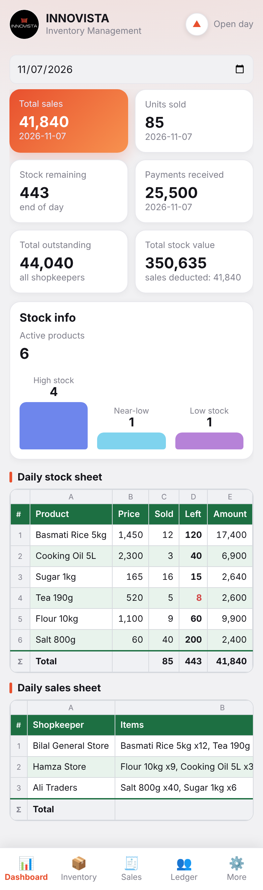 | 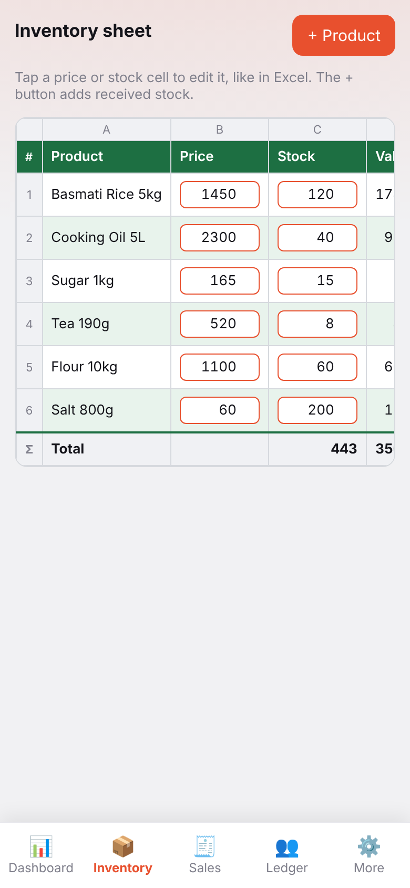 | 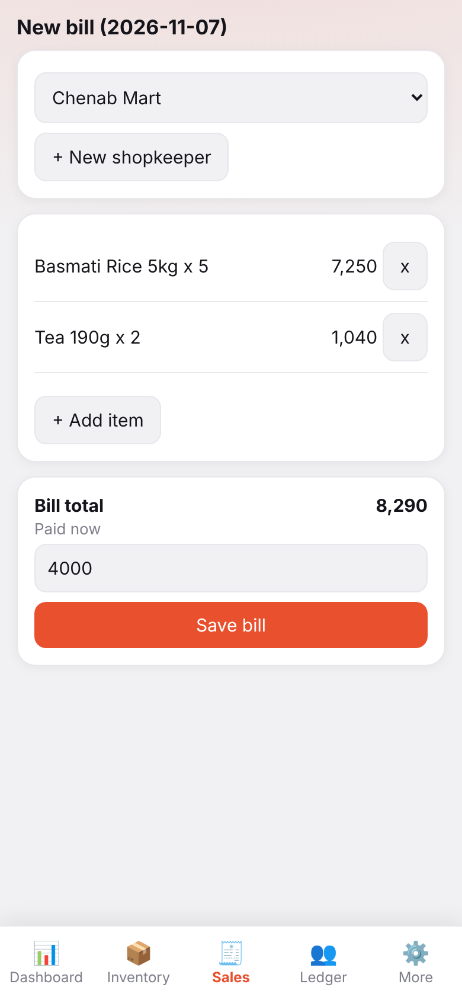 |

| کسٹمر لیجر (کھاتہ) | دکاندار کا تفصیلی کھاتہ | ری سیٹ سینٹر |
|:---:|:---:|:---:|
| 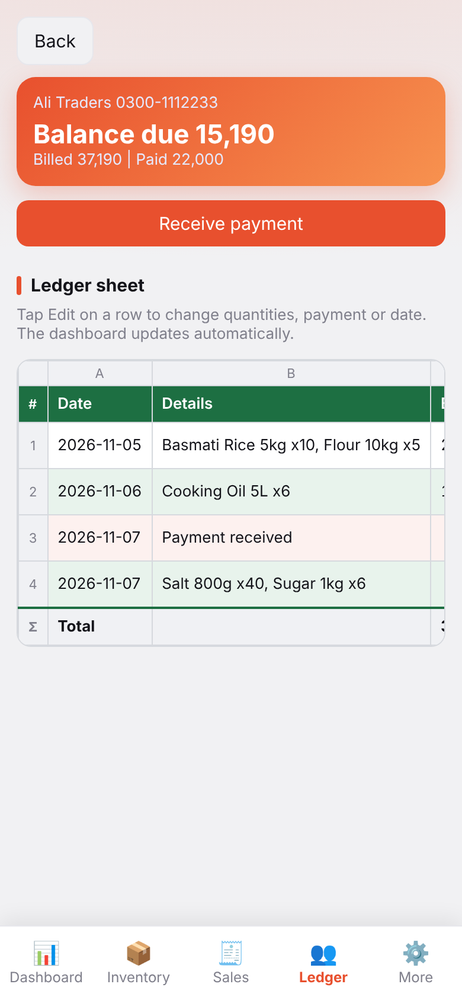 | 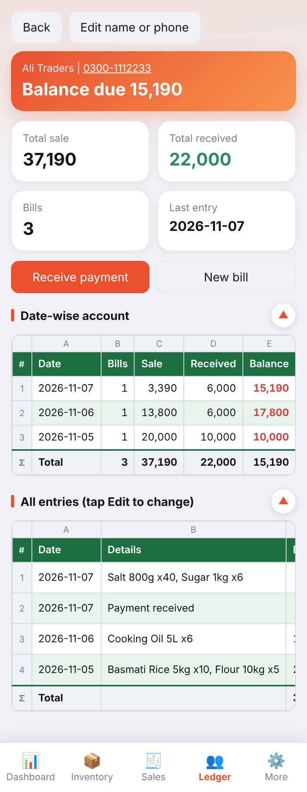 | 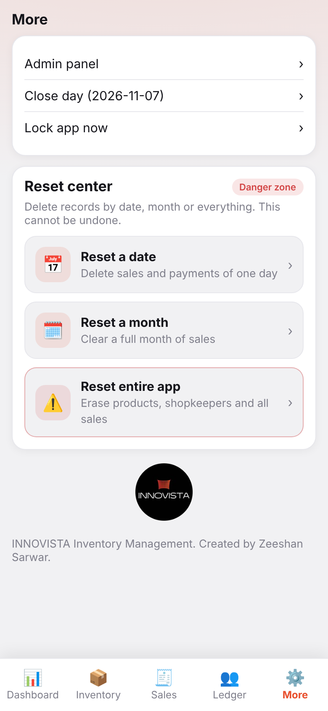 |

| ایڈمن پینل (لاک پروٹیکٹڈ) | ٹیبلٹ ڈیش بورڈ | ٹیبلٹ کھاتہ ویو |
|:---:|:---:|:---:|
| 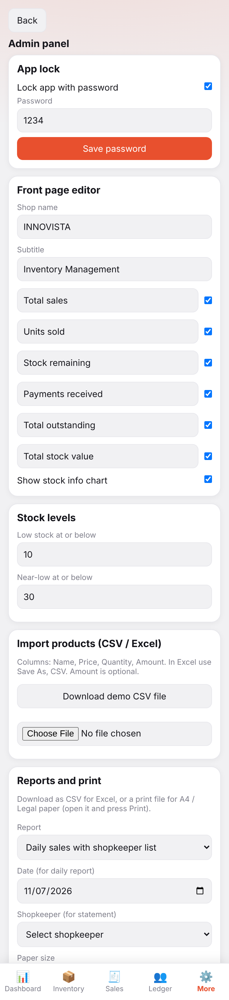 | 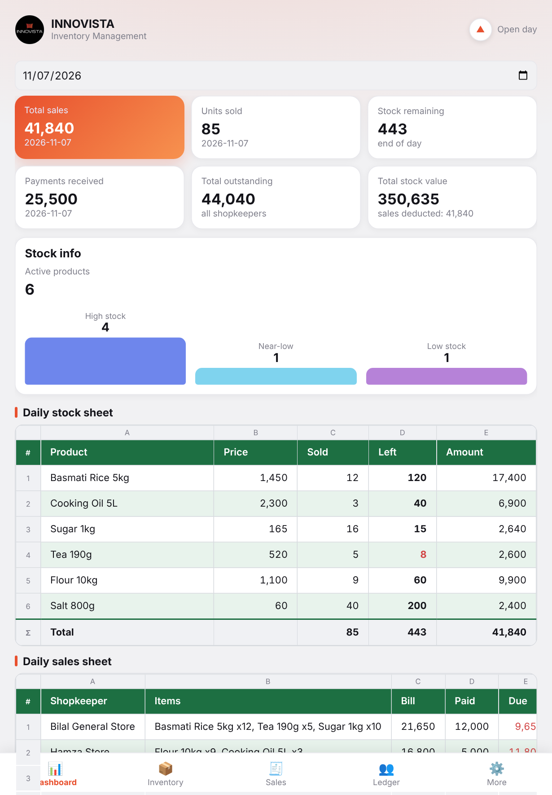 | 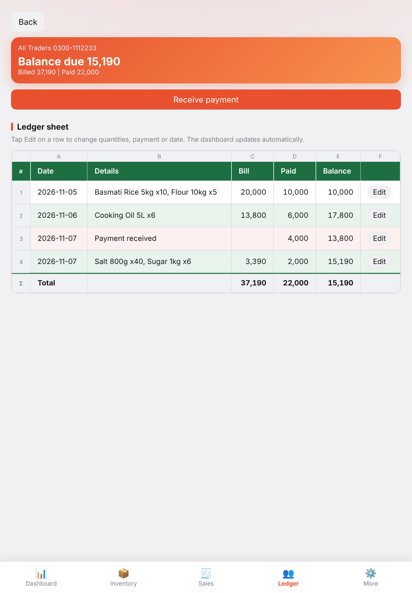 |

| ڈیوائس ایکٹیویشن | کی جنریٹر (مالک کا فون) | ایڈمن لائسنس ویو |
|:---:|:---:|:---:|
| 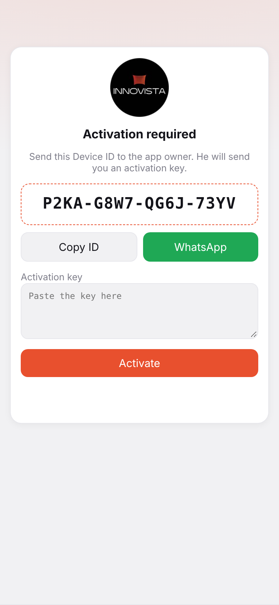 | 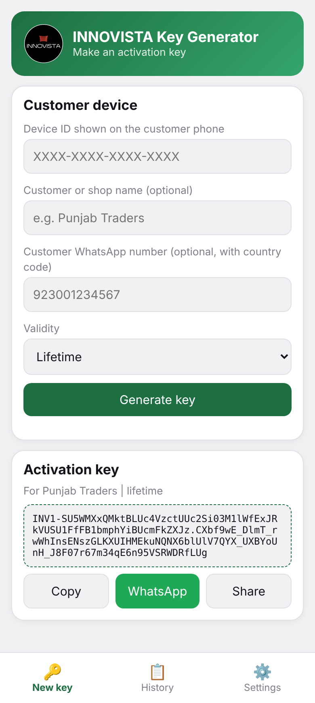 | 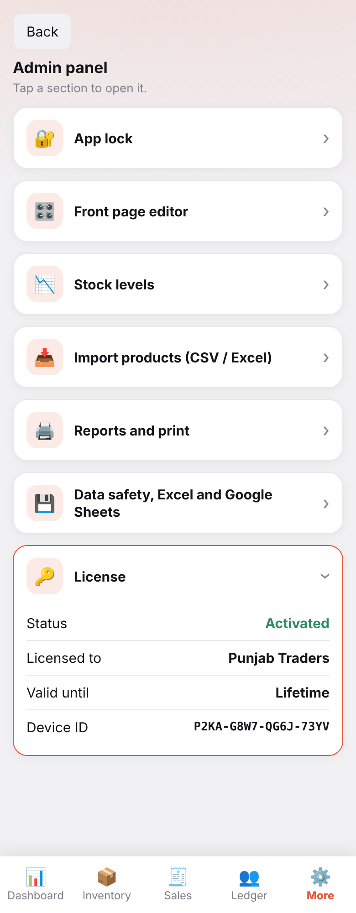 |

---

## 4. استعمال کنندگان کی مکمل گائیڈ (User Manual)

### الف) پہلی بار سیٹ اپ:
1. اپنے فون یا ٹیبلٹ پر `app-debug.apk` یا `Innovista-Inventory-v1.0.apk` انسٹال کریں۔
2. پہلی بار کھولنے پر ایپ کی بنیادی تاریخ آج کی تاریخ پر سیٹ ہو جائے گی۔
3. **ایڈمن پاس ورڈ:** پہلے سے طے شدہ پاس ورڈ `1234` ہے۔ ایڈمن پینل میں جا کر فوری طور پر اپنا ذاتی پاس ورڈ سیٹ کریں اور "App Lock" کو آن کریں۔

### ب) مصنوعات اور اسٹاک کا اندراج:
1. نیچے موجود نیویگیشن بار سے **Inventory** پر کلک کریں۔
2. نیا آئٹم شامل کرنے کے لیے **+ Add Product** کا بٹن دبائیں۔ آئٹم کا نام، فروخت کی قیمت اور ابتدائی اسٹاک لکھیں۔
3. اگر آپ کے پاس پہلے سے ایکسل یا CSV فائل میں سامان کی لسٹ موجود ہے تو **More > Admin Panel > Import Products (CSV)** میں جا کر براہ راست فائل امپورٹ کر سکتے ہیں۔
4. جب فیکٹری یا وینڈر سے نیا مال آئے، تو اس آئٹم کے سامنے والے **+** بٹن پر کلک کر کے موصول شدہ تعداد لکھیں۔

### ج) سیلز اور بل بنانا:
1. نیویگیشن بار سے **Sales** پر کلک کریں۔
2. کسٹمر منتخب کریں (یا نیا کسٹمر شامل کریں)۔
3. **Add Item** دبائیں؛ مطلوبہ پروڈکٹ تلاش کریں اور مقدار لکھیں۔
4. گاہک نے موقع پر جتنے پیسے دیے ہوں وہ **Paid now** میں لکھیں (باقی رقم خودبخود اس کے ادھار کھاتے میں چلی جائے گی)۔
5. **Save Bill** دبائیں۔ بل بنتے ہی انوینٹری سے متعلقہ مال خودبخود کم ہو جائے گا۔

### د) ادھار کی وصولی اور کھاتہ دیکھنا:
1. **Ledger** ٹیب کھولیں۔ یہاں تمام دکانداروں کی لسٹ اور ان کے ذمہ واجب الادا رقم واضح نظر آئے گی۔
2. کسی بھی دکاندار کے نام پر کلک کریں تاکہ اس کا روزنامچہ (کھاتہ) کھل جائے۔
3. جب وہ ادھار واپس کرے تو **Receive payment** پر کلک کریں، رقم لکھیں اور محفوظ کریں۔ کھاتے کا بیلنس فوری اپڈیٹ ہو جائے گا۔

---

## 5. کاروباری و مالیاتی اصول (Business & Accounting Rules)

* **اسٹاک میں تبدیلی کے اصول:** اسٹاک صرف 6 صورتوں میں بدلتا ہے: نئی پروڈکٹ بنانا، `+` بٹن سے مال ڈالنا، انوینٹری شیٹ میں ترمیم، نیا بل، بل میں ترمیم/منسوخی، اور CSV امپورٹ۔
* **پرانے بل کی تدوین:** اگر پچھلی تاریخ کا کوئی بل تبدیل یا ڈیلیٹ کیا جائے تو اس کا اثر پچھلی تاریخ کے کلوزنگ ریکارڈ پر نہیں پڑتا بلکہ موجودہ دن کے رواں اسٹاک پر پڑتا ہے تاکہ گنتی خراب نہ ہو۔
* **بقایا جات کا فارمولا:**  
  $$\text{Shopkeeper Due} = \sum (\text{Bill Total} - \text{Bill Paid}) - \sum (\text{Later Payments})$$
* **کل اسٹاک کی مالیت:** موجودہ تمام اشیاء کا اسٹاک ضرب قیمتِ فروخت (Sale Price) کے حساب سے ماپا جاتا ہے۔

---

## 6. ڈویلپر گائیڈ اور ٹیکنالوجی اسٹیک (Developer Guide & Tech Stack)

یہ پروجیکٹ سوفٹ ویئر انجینئرنگ کے اعلیٰ ترین معیارات پر استوار ہے، جس میں کم سے کم ریسورسز کے ساتھ زیادہ سے زیادہ صلاحیت حاصل کی گئی ہے۔

### استعمال شدہ ٹولز اور ٹیکنالوجیز:
* **فرنٹ اینڈ:** خالص جدید جاوا اسکرپٹ (ES6+ Vanilla JS)، ایچ ٹی ایم ایل 5، سی ایس ایس 3 (CSS Variables, Flexbox, Grid)۔
* **آف لائن انجن:** Service Worker API اور HTML5 Web Storage۔
* **ایکسل انجن:** SheetJS (`xlsx.full.min.js`) برائے آف لائن ملٹی شیٹ ایکسل جنریشن۔
* **اینڈرائیڈ پلیٹ فارم ریپر:** Capacitor 6.2.0 (`@capacitor/core`, `@capacitor/android`, `@capacitor/device`, `@capacitor-community/sqlite`)۔
* **اینڈرائیڈ بلڈ ٹول چین:**
  * OpenJDK 21 LTS
  * Android SDK (API Level 34 اور 36)
  * Android Asset Packaging Tool 2 (AAPT2)
  * Dalvik Executable Compiler (D8)
  * ZipAlign اور Apksigner (v1, v2, v3 اسکیمز)
  * Gradle 8.2.1
* **کوڈ سیکیورٹی و اوبفسکیشن:** `javascript-obfuscator` برائے ویری ایبل انکرپشن، سٹرنگ انکوڈنگ اور کنٹرول فلو پروٹیکشن۔

---

## 7. اینڈرائیڈ APK بنانے کا طریقہ کار (APK Build Guide)

آپ اپنی مرضی کے مطابق دو طریقوں سے APK بنا سکتے ہیں:

### طریقہ نمبر 1: ایک کلک ونڈوز بلڈر (سب سے تیز اور آسان)
روٹ ڈائرکٹری میں موجود `build-apk-direct.bat` پر ڈبل کلک کریں۔ یہ اسکرپٹ براہِ راست انسٹال شدہ اینڈرائیڈ ٹولز کی مدد سے 5 سیکنڈ کے اندر اندر ڈیبگ APK تیار کر دیتا ہے:
```cmd
build-apk-direct.bat
```
تیار شدہ فائل: `Innovista-Inventory-v1.0.apk`

### طریقہ نمبر 2: کیپیسیٹر اور گریڈل کا روایتی طریقہ
```cmd
node tools/set-public-key.js
npm install
npx cap add android
npm run android:sync
cd android
gradlew.bat assembleDebug
```
تیار شدہ فائل کا مقام:  
`android\app\build\outputs\apk\debug\app-debug.apk`

---

## 8. ڈیجیٹل لائسنسنگ اور سیکیورٹی سسٹم

1. **کی جنریٹر ایپ (`keygen/`):** یہ علیحدہ ایپلیکیشن ایپ کے مالک کے ذاتی فون پر چلتی ہے۔ اس میں مالک کا ماسٹر PIN درج ہوتا ہے جو **ECDSA P-256** کی کی مدد سے چابیاں بناتا ہے۔
2. **ڈیوائس آئی ڈی بائنڈنگ:** ہر موبائل کا منفرد ہارڈویئر ID لے کر SHA-256 کے ذریعے 16 ہندسوں کا کوڈ (`XXXX-XXXX-XXXX-XXXX`) بنتا ہے۔
3. **چابی کا سٹرکچر:**
   ```text
   INV1-<Base64Url(Payload)>.<Base64Url(Signature)>
   ```
4. چابی بنانے کا کمانڈ لائن ٹول:
   ```bash
   bun tools/make-key.js "XXXX-XXXX-XXXX-XXXX" "Shop Name" "LIFETIME"
   ```
5. لائسنس کی شرط کو آن یا آف کرنے کے لیے:
   ```bash
   bun tools/toggle-license.js
   ```

---

## 9. ڈیٹا بیس اور آف لائن اسٹوریج سسٹم

اینڈرائیڈ کے اندر ڈیٹا **SQLite** ڈیٹا بیس میں محفوظ ہوتا ہے ([db/schema.sql](db/schema.sql))، جبکہ بیک اپ کاپی متوازی طور پر `localStorage` میں رکھی جاتی ہے۔

### بنیادی ٹیبلز:
* `products`: پروڈکٹس کا نام، قیمت، اسٹاک، بارکوڈ اور اسٹیٹس۔
* `customers`: دکانداروں کے نام، فون اور ایڈریس۔
* `sales`: تاریخ، گاہک، کل بل، ادا شدہ رقم اور نوٹس۔
* `sale_items`: ہر بل کی انفرادی اشیاء، مقدار اور قیمت۔
* `payments`: بعد میں موصول ہونے والی نقد رقوم۔
* `day_closings` اور `closing_stock`: یومیہ اسٹاک اسنیپ شاٹس۔

---

## 10. عمومی سوالات اور مسائل کا حل (FAQ & Troubleshooting)

* **سوال: کیا انٹرنیٹ بند ہونے پر یہ ایپ کام کرے گی؟**  
  **جواب:** جی ہاں، یہ 100% آف لائن چلتی ہے۔ انٹرنیٹ کی بالکل ضرورت نہیں ہے۔

* **سوال: اگر موبائل گم ہو جائے تو ڈیٹا کیسے بچے گا؟**  
  **جواب:** روزانہ یا ہفتہ وار ایڈمن پینل میں جا کر **Download backup file** دبائیں اور وہ فائل اپنے واٹس ایپ یا گوگل ڈرائیو پر محفوظ کر لیں۔ نئے موبائل پر ایپ انسٹال کر کے **Restore from a backup file** کے ذریعے سارا ڈیٹا ایک سیکنڈ میں واپس آ جائے گا۔

* **سوال: کیا ہم پرنٹ نکال سکتے ہیں؟**  
  **جواب:** جی ہاں، ایڈمن پینل میں یومیہ، ماہانہ رپورٹس اور کسٹمر لسٹ کے لیے A4 اور لیگل سائز پرنٹ ریڈی پیجز موجود ہیں۔

---
**تخلیق و ترقی:** محمد ذیشان سرور | گٹ ہب ریپوزٹری: [zeeshansarwar1986](https://github.com/zeeshansarwar1986)

